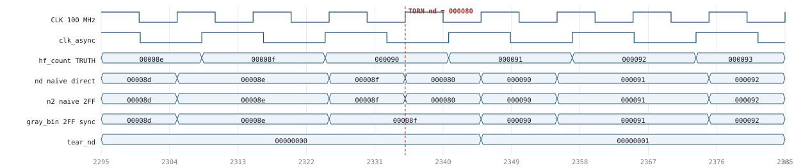
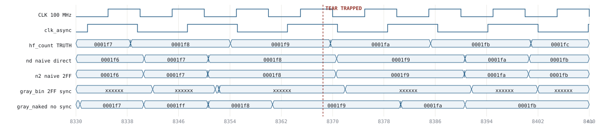

# Two toolchains, one design

What an open FPGA flow and a vendor flow can each see, run against byte-identical
RTL — and where each one is blind.

The short version: **the open flow plus a board proves the phenomena. The vendor
flow proves the analysis.** Those are different skills and different evidence,
and neither substitutes for the other. This note records which is which, with
measurements rather than assertions.

| | Open flow + hardware | Vivado flow |
|---|---|---|
| Answers | Does it actually tear? | Would a competent toolchain have caught it? |
| Target | iCE40UP5K, iCEBreaker V1.1a | Artix-7 `xc7a35ticsg324-1L` |
| Evidence | Hardware event counters | Static analysis + SDF-annotated simulation |
| Metastability | **Real** — the only place it exists | **Absent** — not modelled anywhere |
| CDC checking | **None** — no lint, no warning | `report_cdc`, structural, netlist-walking |
| Cost / iteration | Free, ~1 s | $0.179/hr; 36 s synth+impl, 14 min timing sim |

The design under test is one 24-bit counter in an asynchronous clock domain, read
five ways — two correct, three deliberately wrong. See the
[project README](../cdc_corruption_a7/README.md) for the register map, the stage
list and the full measured results.

---

## Flow one — open toolchain and hardware

Free, local, and fast enough to run on every commit. The board is the point: it
is the only place in either flow where metastability physically occurs.

| Tool | Role | Notes |
|---|---|---|
| `yosys` | Synthesis | `synth_ice40` |
| `nextpnr-ice40` | Place & route | Reports estimated Fmax |
| `icepack` / `iceprog` | Bitstream / programming | IceStorm; one USB cable via FT2232H |
| `icetime` | Static timing | Basic. No SDC, no exceptions, no clock-interaction report |
| `iverilog` / `vvp` | Event simulation | Also used inside the Artix-7 project for laptop smoke tests |
| `verilator` | Fast cycle simulation | cocotb backend |
| `cocotb` 2.0.x | Python testbenches | Runs from a repo-root `.venv` on Python 3.11 |
| `yosys-smtbmc` + z3 | Formal proof | Temporal induction + cover on the FIFO and the CDC handshake |
| GitHub Actions | CI | `make sim` + `make`, every project, every push |
| iCEBreaker V1.1a | Hardware | iCE40UP5K, 12 MHz crystal, `SB_HFOSC` internal RC oscillator |

### Why the hardware measurement is trustworthy

The tear counters live **in the fabric**. `corrupt.v` increments a sample counter
on every crystal edge and a tear counter whenever a read jumps by more than a
plausible step. The rate is `Δtears / Δsamples × 12 MHz`, computed on-chip.

The UART only controls how often the host reads the snapshot — the FTDI latency
timer changes readout cadence, not the denominator. Counting in hardware rather
than sampling from the host is the entire reason the number means anything.

| Read path | Method | Torn reads/s | |
|---|---|---:|---|
| handshake | Request/ack freeze-then-read | 0 | correct |
| gray + 2FF | Gray encode, 2-flop sync, decode | 0 | correct |
| naive direct | One flop per bit | 46,078 | **tears** |
| naive per-bit 2FF | *Every bit* through a 2-flop synchronizer | 46,078 | **tears** |
| gray, no sync | Gray decoded from the raw async bus | 113,893 | **worse** |

Two results worth internalising. **Per-bit two-flop synchronization is exactly as
broken as naive** — identical counts. It fixes metastability per bit and leaves
multi-bit *coherence* untouched, so the assembled word is one the counter never
held. And **gray coding without a synchronizer is worse than naive**, because the
gray→binary decoder is a fan-out XOR cascade that amplifies the single metastable
bit. Gray fixes coherence; flops fix metastability. Orthogonal, and you need both.

---

## Flow two — where it lives in AWS

Vivado does not run on Apple Silicon — x86-64 Linux or Windows only — so the
vendor flow lives on one EC2 instance, deliberately small, started and stopped by
hand. Full provisioning and cost detail in [SETUP.md](../SETUP.md).

| | |
|---|---|
| Instance | `c7i.xlarge` — 4 vCPU, 8 GiB, Sapphire Rapids 3.2 GHz |
| Region / AZ | `us-east-1` / `us-east-1c` |
| AMI | `ubuntu-noble-24.04-amd64-server-20260714` |
| Storage | 100 GB gp3, 3000 IOPS, 125 MB/s |
| Security group | TCP 22 from one `/32`. No DCV port opened. |
| Key pair | ed25519, generated locally, public half imported — private key never transited the AWS API |
| Hardening | IMDSv2 required; shutdown behaviour = stop, not terminate |
| Toolchain | Vivado ML Standard 2025.2 in `/opt/Xilinx` — 52 GB, Artix-7 device family only |

### Three sizing decisions

**Compute-optimised, not memory-optimised.** AMD's own table puts `xc7a35t` at
2 GB typical, 3 GB peak. Measured peak during implementation: **2982 MB**. The
widely repeated "8 GB for Artix-7" would have been 2.7× oversized. Synthesis,
much of P&R and all SDF simulation are effectively single-threaded, so clock rate
beats core count.

**The volume is the cost, not the instance.** 100 GB gp3 bills ~$8/month whether
or not the instance runs. Compute for the entire build-out was ~$2.50. Stopping
keeps the 52 GB install; terminating throws away a 35-minute download.

**Pinned to 2025.2 on purpose.** From 2026.1 AMD moved to five licensing tiers,
and reporting says the free BASIC tier excludes Linux — which is the whole premise
of a Linux instance. AMD had not clarified this as of May 2026. 2025.2 removes the
question and needs no licence file.

### Headless install

The web installer authenticates interactively; everything after that is scriptable.

1. Copy the 347 MB web installer up — only the small file crosses the home link.
2. `xsetup -b AuthTokenGen` — prompts for AMD credentials, caches a token in
   `~/.Xilinx`. The one interactive step.
3. `xsetup -b ConfigGen`, then edit: destination `/opt/Xilinx`, and **one device
   family enabled out of 26**.
4. Batch install. 17.08 GB pulls straight to the instance at backbone speed;
   35 minutes, 52 GB on disk. Batch mode also avoids the splash-screen failure the
   GUI installer hits with no X11.
5. `installLibs.sh` as root, then confirm the part: `get_parts xc7a35ticsg324-1L`.

---

## Flow two — the tools

Non-project mode throughout: no `.xpr`, no GUI state, nothing to recreate by hand
after a clone. One Tcl script drives every stage.

| Stage | Commands | Wall |
|---|---|---:|
| `behav` | `xvlog`, `xelab`, `xsim` (UNISIM + glbl) | ~1 min |
| `synth` | `synth_design`, `DONT_TOUCH`, `ASYNC_REG`, `set_max_delay -datapath_only`, `set_bus_skew` | ~1 min |
| `cdc` | `report_cdc`, `report_clock_interaction`, `check_timing`, `report_exceptions -ignored` | seconds |
| `impl` | `opt_design` → `place_design` → `phys_opt_design` → `route_design` → `write_bitstream` | 36 s |
| `timing` | `xelab -L simprims_ver -transport_int_delays`, SDF-annotated | 14 min |
| `trap` | Two-pass: locate the first tear, then dump ±200 ns | ~10 min |

**Why trapping an event takes two passes.** A VCD cannot rewind, so nothing can
decide to start dumping after the interesting thing already happened. Pass one
dumps nothing and reports when the first tear occurred; pass two re-runs and dumps
a narrow window around it. Sound only because the testbench is deterministic — no
`$random`, a fixed phase sawtooth — so both passes trigger at the identical
simulated instant. On the open flow this shrank a dump from 5.7 MB to 27 KB.

---

## The same failure, seen in both flows

### Open flow — Icarus with injected bus skew



At 2335 ns the naive read returns `0x000080` while the counter goes
`0x8f → 0x90`. It was never `0x80`. That transition is a four-bit carry —
`1000 1111 → 1001 0000` — and this capture caught bits 0–3 already cleared with
bit 4 not yet arrived. Every bit is individually correct at some instant; the
assembled word is correct at none. `gray_bin` tracks the counter cleanly.

**Caveat that must travel with this picture:** a behavioural simulator has no
setup/hold model and cannot tear on its own. This run injects ~2 ns of per-bit
routing skew (`SIM_SKEW`). The *mechanism* is real — unconstrained routes, bits
arriving at different times, per-bit synchronizers powerless against it — but the
*rate* is a property of the injected delays, not of silicon. Never quote it.

### Vivado flow — post-implementation, SDF-annotated



Post-route netlist with SIMPRIM cells and SDF back-annotated from the actual
placed-and-routed design. No injected model — these are the delays Vivado's own
router produced. Two things to read:

`gray_naked` — correct gray coding, **no synchronizer** — reads `0001ff` while the
counter is stepping `0001f7 → 0001f8`. The counter never held `0001ff`.

And `gray_bin`, the **correct** gray + 2FF path, reads `xxxxxx` across the whole
window. That second one matters more than the first, and it is not a bug — see
below.

One detail too narrow to see at this zoom but present in the VCD: at 8369.663 ns
`hf_count` itself dips to `0001f8` for **9 picoseconds** before settling to
`0001fa` — the carry chain propagating through real CARRY4 and routing delay. A
behavioural simulator has no such transient; the bus changes atomically. That 9 ps
window is what the unsynchronized decoder samples into.

---

## What the vendor flow reported

Full stage-by-stage results are in the
[project README](../cdc_corruption_a7/README.md). Three findings carry the
argument.

### 1. The CDC audit, as a known-answer test

Three bugs planted on purpose, two correct references alongside them, and
hardware-measured failure rates already in hand.

```
CDC severity tally:  Critical=72  Warning=25  Info=2

CDC-1   Critical  24  1-bit unknown CDC circuitry             <- gray, NO synchronizer
CDC-11  Critical  48  Fan-out from launch flop to dest clock  <- naive direct + naive 2FF
CDC-15  Warning   24  Clock enable controlled CDC structure
CDC-6   Warning    1  Multi-bit synchronized with ASYNC_REG   <- gray + 2FF   (correct)
CDC-3   Info       2  1-bit synchronized with ASYNC_REG       <- handshake    (correct)

known-answer check: PASS
```

A CDC report tells you what the checker *noticed*; it can never tell you what it
*missed*. Calibrating against known answers first is what makes its verdict on
unfamiliar code worth anything. `report_cdc.tcl` fails the run on zero Critical
findings — on this design a clean report means the tool is broken, not the design.

### 2. Clean and Critical, same design, same run

```
clock_interaction.rpt, post-route:

clk_async -> sys_clk     121 endpoints   Ignored   Asynchronous Groups
sys_clk   -> clk_async     1 endpoint    Ignored   Asynchronous Groups
sys_clk   -> sys_clk      WNS 1.610      Clean     Timed
clk_async -> clk_async    WNS 10.081     Clean     Timed
```

**Every timed clock pair is Clean. 122 endpoints are Ignored. `report_cdc` returns
72 Critical findings on those same ignored paths.**

The timing summary is not lying. `set_clock_groups -asynchronous` excused those
paths from analysis, and excusing them changed nothing about silicon that tears
46,000 times a second on the bench. Timing exceptions suppress the timing engine;
the CDC engine walks the netlist structurally and finds the crossings anyway. That
asymmetry is the entire argument for running both — and the reason a green timing
summary is not evidence of a safe design.

### 3. Timing simulation, and the limit of it

47,798 `$setuphold` violations, distributed exactly where theory says:

| Capture flop | Violations | Role |
|---|---:|---|
| `u_c/nd_r_reg` | 17,170 | naive direct — stage 1, result used directly |
| `u_c/n2_meta_reg` | 15,597 | naive 2FF — stage 1 |
| `u_c/gray_meta_reg` | 8,442 | gray + 2FF — stage 1 |
| `u_c/gray_naked_reg` | 6,589 | gray, no synchronizer |
| `u_c/gray_sync_reg` | **0** | **gray + 2FF — stage 2** |
| `u_hs/stamp_q`, `u_hs/data` | **0** | **handshake** |

Violations on stage 1 of the *correct* gray path are not a defect — absorbing
metastability is precisely what stage 1 exists to do. Stage 2 takes none, and
neither does the handshake; the naive paths have no stage 2 at all. That is a real
structural result.

**But do not over-read it.** In the waveform above, the correctly synchronized
`gray_bin` output is `xxxxxx`. X from the stage-1 violation propagates straight
through stage 2, because the simulator cannot model metastability *resolving*.
Timing simulation is **X-pessimistic across every synchronizer**: it renders
working and broken CDC identically at the data level. It tells you *which flops
are being hit*, not *which designs survive*. Anyone signing off CDC on the
strength of a timing simulation is reading it wrong.

Structure comes from `report_cdc`. Behaviour comes from silicon. Neither is
optional.

---

## Four times a tool reported success while failing

Every one of these produced a run that looked healthy. None are Verilog bugs —
they are failures of tool trust, which is why they are recorded here rather than
quietly fixed.

**1 — XDC is not Tcl.** Vivado's constraint reader is a restricted command set.
`if` is rejected as a *CRITICAL WARNING, not an error*, so the block is skipped
and the run continues. The conditional creating `clk_async` never executed, the
design synthesized with one clock, and `report_cdc` truthfully reported zero
crossings in a design made entirely of crossings.
*Fix:* XDC strictly declarative; anything needing a guard moves to real Tcl.

**2 — `report_cdc -return_string` needs `-details`.** Without it you get the
per-clock-pair summary, whose rows start with the severity and carry no `CDC-nn`
rule ID. ID-based parsing matched nothing, and the gate announced "zero Critical
findings" against a report listing 72.
*Fix:* parse the details table, and separate *cannot read the report* from *read
it, findings are wrong*.

**3 — `-sdfmax` cannot match escaped instance names.** Post-route instances
contain brackets (`hf_count[0]_i_1`), which become escaped Verilog identifiers.
XSim skipped **1486 of 1487** instances one warning at a time — while printing
`SDF backannotation was successful` for the file. A timing simulation with no
timing, and the tear counts it produced were not physical.
*Fix:* `write_verilog -sdf_anno true` lets the netlist self-annotate. Skips
1486 → 0, and real `$setuphold` violations appear.

**4 — Sticky trigger bits.** The trap watched `led[3:1]`, which latch "counter
non-zero" and never clear. "First tear" therefore meant "any tear ever, including
during GSR" — and the unsynchronized path always scores one at reset. It fired on
a reset artifact at exactly t=1000 ns. Arming late then overcorrected and masked
the real events.
*Fix:* snapshot what is already dirty, fire on the first bit dirtied after.

Numbers 2 and 3 are the instructive pair: both were tools reporting **success at
one level while failing completely at another**, and both would have produced a
confident, wrong writeup. The only reason either was caught is that the expected
answer was known in advance and the gate refused to pass without it.

---

## Overlap, and the division of labour

The overlap is larger than expected. The RTL is **byte-identical** across both
flows — source commit and SHA-256 digests recorded in
[`rtl/PROVENANCE.md`](../cdc_corruption_a7/rtl/PROVENANCE.md), re-checkable with
`make check-sync`. Only the top level differs, because only the top level was ever
vendor-specific. Both flows are Makefile-driven, both emit VCD, and Icarus is used
in *both* — it runs a one-second laptop smoke test of the Artix-7 project before
anything touches EC2.

**What the open flow does better**

- **It has a board.** Metastability exists nowhere else. Vivado models setup/hold
  windows; only silicon resolves them.
- **Speed.** Elaborate and run in about a second, so it goes in CI on every push.
  Vivado's timing sim is 14 minutes for 30 µs.
- **Formal.** `yosys-smtbmc` with z3 proves the FIFO and the CDC handshake by
  temporal induction. The free Vivado edition has no equivalent.
- **No licence, no cloud, no account.**

**What Vivado does that the open flow cannot**

- **`report_cdc`.** Structural, netlist-walking CDC detection. The open flow built
  an unsynchronized crossing *silently* — no lint, no warning, nothing.
- **`report_clock_interaction`.** Classifies every clock pair as Timed / Ignored /
  Partially constrained. This is what makes the "clean but ignored" contrast
  visible at all.
- **A real exception language.** `set_max_delay -datapath_only`, `set_bus_skew`,
  `set_clock_groups`, `ASYNC_REG`. `icetime` has none of it. Note the distinction
  that matters: max_delay bounds each bit, `set_bus_skew` bounds the *spread* — a
  crossing can meet max_delay on all 24 bits and still tear.
- **SDF timing simulation.** Real `$setuphold` checks on a routed netlist, with
  the limits described above.
- **Constraint coverage.** `check_timing` and `report_exceptions -ignored` find
  unconstrained endpoints and exceptions that match nothing — constraints quietly
  doing zero while everyone assumes they are load-bearing.

**In one line:** the board answers *does it tear*. Only a vendor flow answers
*would a competent toolchain have caught this before tape-out*.

---

## What is not proven

- **No MTBF numbers.** `report_synchronizer_mtbf` is unsupported on the 7a35ti.
- **No metastability events harvested.** At 12 MHz an iCE40 flop gets 83 ns to
  resolve (t_r/τ ≈ 250), so zero events is the *correct* result and no amount of
  patience changes it. Honest harvesting needs a deliberately shrunken settling
  window — an MMCM with dynamic phase shift.
- **Timing simulation cannot confirm a synchronizer works.** X-pessimism means the
  correct gray + 2FF path reads `xxxxxx` in the annotated run.
- **Simulation tear rates are meaningless.** The testbench deliberately sweeps the
  async phase to hunt the aperture, samples at 100 MHz against the board's 12 MHz,
  and the SDF is the slow corner. The ordering is the result; the magnitude is not.
- **The Artix-7 design has never been on a board.** Everything in flow two is
  analysis and simulation.
- **No constraint audit of a design someone else wrote.** The bugs here were
  planted deliberately, which is what makes the tool calibration valid — and also
  what keeps this short of being a worked audit.
